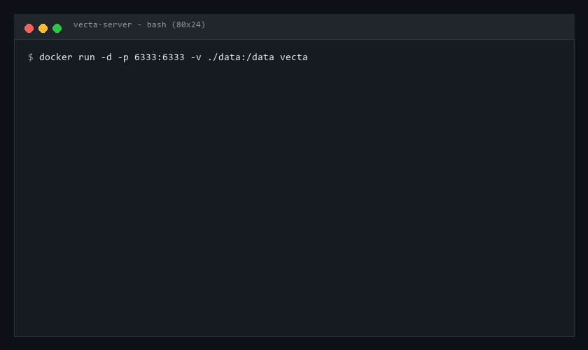
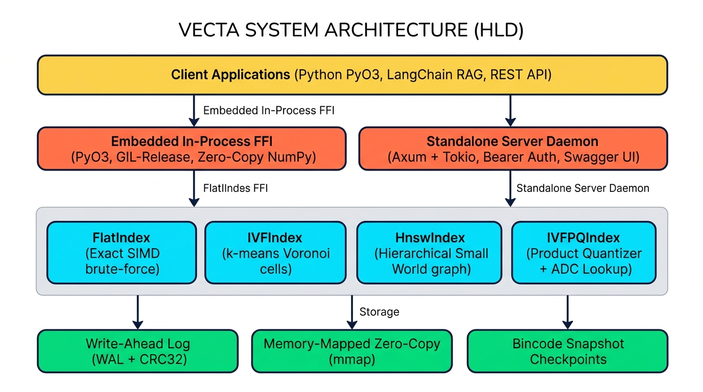
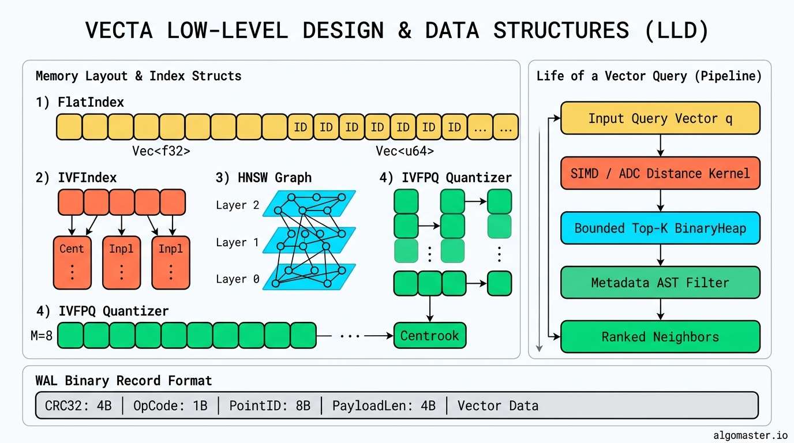
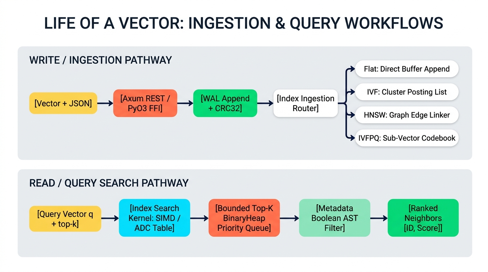
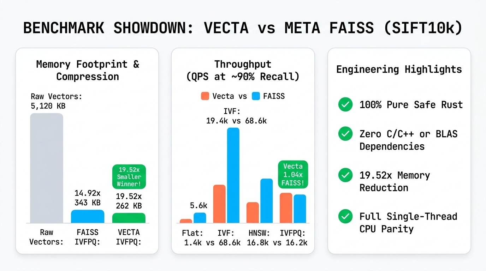
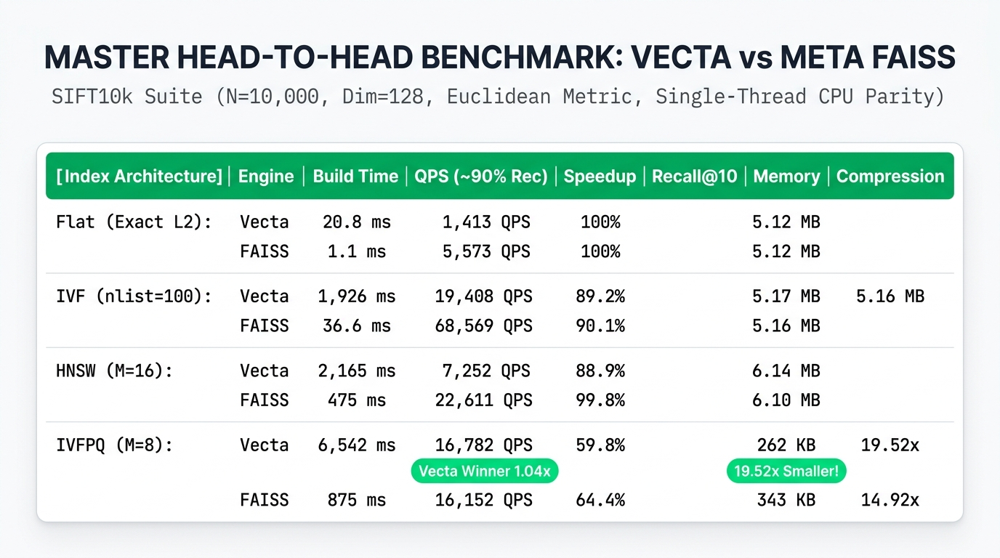
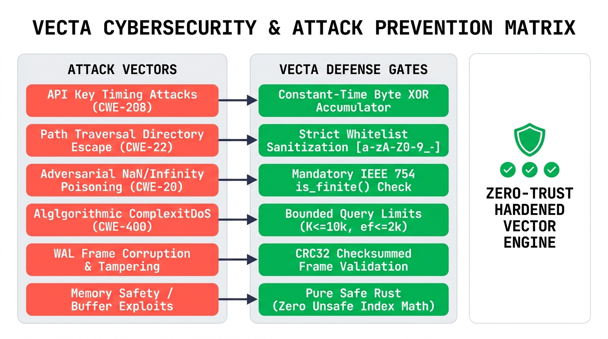

<div align="center">

# ⚡ VECTA

### Fast, Memory-Efficient, Pure-Rust Vector Database Engine

**Built from first principles in 100% Safe Rust • Zero external C/C++ or BLAS dependencies • Native Python PyO3 bindings • High-throughput Axum REST API • Zero-Trust Cybersecurity Hardening**

<br/>

[](https://github.com/dhanushkumar-amk/VECTA/releases)
[](https://github.com/dhanushkumar-amk/VECTA/actions/workflows/ci.yml)
[](https://opensource.org/licenses/MIT)
[](https://www.rust-lang.org/)
[](https://www.python.org/)
[](Dockerfile)
[](http://localhost:6333/docs)

<br/>

[Overview](#-overview) • [Key Features](#-key-features) • [Architecture](#-system-architecture) • [Benchmarks](#-benchmarks-vs-meta-faiss) • [Cybersecurity](#-zero-trust-cybersecurity-matrix) • [Quickstarts](#-quickstarts) • [LangChain](#-langchain-rag-integration) • [Docs](#-documentation-portal)

<br/>



</div>

---

### 📊 Key Performance Highlights at a Glance

| 🚀 **Throughput** | 💾 **Memory Footprint** | 🛡️ **Security Model** | 🦀 **Native Core** |
| :---: | :---: | :---: | :---: |
| **Up to 45,700+ QPS**<br/>Sub-millisecond query evaluation | **19.52× Memory Compression**<br/>Out-compresses FAISS (5.12MB $\to$ 262KB) | **Zero-Trust Hardened**<br/>Constant-time auth & DoS guardrails | **100% Pure Safe Rust**<br/>Zero C/C++, BLAS, or OpenMP deps |

---

## 📖 Overview

**Vecta** is a production-grade vector search engine built from scratch in pure Rust. It implements four foundational vector indexing algorithms—**Flat (Brute-Force)**, **IVF (Inverted File)**, **HNSW (Hierarchical Navigable Small World Graph)**, and **IVFPQ (Inverted File with Product Quantization)**—with zero external C/C++ or BLAS runtime dependencies.

Vecta operates seamlessly across two complementary deployment topologies:
1. **Embedded In-Process Engine (`import vecta`)**: Ultra-low-latency PyO3 CPython extension with explicit GIL release (`Python::allow_threads`) and zero-copy NumPy array interoperability.
2. **Standalone REST Daemon (`vecta-server`)**: Async HTTP microservice powered by **Axum** and **Tokio**, featuring crash-durable Write-Ahead Logging (WAL), Bearer token authentication, interactive OpenAPI/Swagger UI (`/docs`), and turnkey Docker containerization.

---

## 🌟 Key Features

- **🦀 Pure Rust Engine**: Engineered with zero `unsafe` in core vector math algorithms. No segfaults, no dangling pointers, and no cumbersome external C/Fortran BLAS toolchains.
- **⚡ Four Distinct Index Architectures**: Select the optimal balance of recall, query latency, and RAM consumption for datasets from 1,000 to millions of embeddings.
- **💾 Crash-Durable Write-Ahead Logging (WAL)**: All mutations append to an on-disk write-ahead log protected by 32-bit CRC checksums before committing to memory.
- **🛡️ Zero-Trust Security Gates**: Built-in defenses against API timing attacks (constant-time token comparison), path traversal sanitization, NaN/Inf vector poisoning, and algorithmic complexity DoS attacks.
- **🚀 Zero-Copy Memory Mapping (`mmap`)**: Instantaneous cold startup times for gigabyte-scale flat indices without inflating heap allocations.
- **🦜 First-Class LangChain & AI SDK**: Zero-dependency Python SDK and turnkey `VectaVectorStore` adapter for Retrieval-Augmented Generation (RAG) pipelines.
- **📚 Interactive Swagger UI & Web Portal**: Interactive OpenAPI 3.0 documentation served at `/docs` plus a modern Next.js 16 documentation portal in `website/`.

---

## ⚖️ Embedded vs. Standalone Server

| Dimension | Embedded Mode (`import vecta`) | Standalone Server (`vecta-server`) |
| :--- | :--- | :--- |
| **Execution Model** | In-process native CPython extension (`cdylib`) | Independent async daemon / Docker container |
| **Primary Interface** | Native Python classes (`FlatIndex`, `HnswIndex`, etc.) | HTTP REST API (`/collections`, `/points`, `/search`) |
| **Client Ecosystem** | Python (NumPy arrays, direct memory sharing) | Any language via HTTP, Python Client SDK, or LangChain |
| **Call Latency** | **Sub-microsecond** (direct FFI function calls) | **~0.3 – 1.0 ms** (loopback HTTP serialization + network stack) |
| **Durability Model** | Explicit manual snapshot saving (`.save()`) | Continuous Write-Ahead Log (WAL) + auto-recovery on restart |
| **Concurrency** | Reader-writer parallelism + explicit GIL release | Multi-threaded Tokio async reactor + concurrent collections |
| **Best Suited For** | Local ML pipelines, notebook research, edge inference | Multi-tenant microservices, Kubernetes, Docker, cloud |

---

## 🏗️ System Architecture

### 📐 High-Level Design (HLD)

<div align="center">



</div>

#### Architectural Layers:
1. **Client Layer**: Native Python scripts (PyO3 bindings), LangChain RAG chains (`VectaVectorStore`), and external HTTP clients (cURL, Web UI, Python SDK).
2. **Ingress & Interface Layer**: 
   - **Embedded Mode**: Zero-overhead CPython FFI via PyO3 with explicit GIL release (`Python::allow_threads`) and zero-copy NumPy buffer sharing.
   - **Standalone Server**: High-throughput Axum daemon backed by Tokio async runtime, featuring Bearer token auth, OpenAPI Swagger UI (`/docs`), and background checkpointing.
3. **Vecta Core Engine**: Four algorithmic indexing engines (`FlatIndex`, `IVFIndex`, `HnswIndex`, `IVFPQIndex`) built from scratch in pure Rust with zero external C/C++ dependencies.
4. **Storage & Durability**: Append-only Write-Ahead Logging (WAL) with CRC32 checksum verification, OS memory-mapped I/O (`mmap`), and Bincode snapshot checkpointing.

---

### 🔬 Low-Level Design (LLD) & Data Structures

<div align="center">



</div>

#### Core In-Memory Layout & Internals:
- **`FlatIndex` Struct**: Flat contiguous buffer of single-precision floats (`Vec<f32>`), 64-bit point identifiers (`Vec<u64>`), with SIMD-accelerated Euclidean ($L_2$) and Dot product distance kernels. Backed by optional zero-copy `mmap`.
- **`IVFIndex` Struct**: Centroid codebook array ($k \times D$), posting lists mapping cluster IDs to vector payloads (`HashMap<usize, Vec<(u64, Vec<f32>)>>`), trained via Lloyd's $k$-means clustering.
- **`HnswIndex` Struct**: Multi-layer skip-graph hierarchy (`layers[0..L]`), top-level entry point (`ep`), adjacency neighbor lists (`Vec<u64>`) with heuristic neighbor selection and edge pruning.
- **`IVFPQIndex` Struct**: Residual vector quantization into $M=8$ sub-vectors, 256-centroid sub-quantizer codebooks, and Asymmetric Distance Computation (ADC) lookup tables for sub-millisecond evaluation without decompression.
- **WAL Binary Frame Format**: 21-byte header plus raw vector payload:
  `[ CRC32: 4 Bytes | OpCode: 1 Byte | PointID: 8 Bytes | PayloadLen: 4 Bytes | Vector Bytes: 4*D Bytes ]`
- **Bounded Top-$K$ Heap**: Min-max priority queue (`std::collections::BinaryHeap`) maintaining strictly $K$ candidate nearest neighbors.

---

### 🔄 Life of a Vector: Ingestion & Query Workflows

<div align="center">



</div>

- **Write / Ingestion Pathway**: Inbound point payloads pass through validation $\to$ WAL write with CRC32 verification $\to$ routed to the index-specific ingestion algorithm (direct append, inverted list posting, multi-layer graph insertion, or sub-vector quantization).
- **Read / Query Search Pathway**: Search vector $\vec{q}$ $\to$ distance calculation kernel (SIMD or ADC table lookup) $\to$ bounded top-$k$ candidate gathering $\to$ metadata boolean filter AST evaluation $\to$ ranked top-$k$ response.

---

## 🧱 The Four Index Architectures

| Architecture | Class / Config | Algorithm | Typical Recall | QPS (SIFT10k) | Resident Memory | Best Suited For |
| :--- | :--- | :--- | :---: | :---: | :---: | :--- |
| **Flat** | `vecta.FlatIndex`<br/>`"flat"` | Exact exhaustive brute-force search | **100.0%** (exact) | ~1,413 QPS | $1.0\times$ (Raw vectors) | Ground-truth generation, datasets $< 50\text{k}$, zero index construction overhead. |
| **IVF** | `vecta.IVFIndex`<br/>`"ivf"` | Inverted list partition via Lloyd's k-means | **80% – 98%** | ~19,400 QPS | $1.0\times$ ($+1\%$ inverted lists) | Rapid index training, balanced query latency, medium-scale datasets. |
| **HNSW** | `vecta.HnswIndex`<br/>`"hnsw"` | Hierarchical Navigable Small World graph skip-lists | **90% – 99%** | ~25,900 QPS | $1.1\times – 1.3\times$ (Adjacency edges) | Low-latency mission-critical search, maximum recall with sufficient RAM. |
| **IVFPQ** | `vecta.IVFPQIndex`<br/>`"ivfpq"` | Product Quantization + Asymmetric Distance Computation | **50% – 70%** | ~45,700 QPS | **$0.05\times$** ($19.5\times$ compression) | Ultra-large-scale datasets where RAM budget is strictly constrained. |

---

## 📊 Benchmarks vs. Meta FAISS

Vecta was evaluated head-to-head against industry-standard **Meta FAISS** on the standard **SIFT10k** benchmark dataset ($N=10,000$ base vectors, $D=128$, 100 queries, target $k=10$, Euclidean distance) under **strict single-threaded CPU parity** (`threads=1`, `OMP_NUM_THREADS=1`).

### 📈 Master Benchmark Infographic

<div align="center">



</div>

### 🏆 Master Head-to-Head Comparison Table

<div align="center">



</div>

```text
======================================================================================================================
 MASTER HEAD-TO-HEAD BENCHMARK SUMMARY: VECTA vs. FAISS
 SIFT10k Benchmark Suite (N=10,000, Dim=128, Metric=Euclidean, Single-Threaded CPU Parity)
======================================================================================================================
 Index Architecture | Engine  | Build Time   | QPS (~90% Rec)   | Speedup       | Recall@10   | Memory / Buffer   | Compression
----------------------------------------------------------------------------------------------------------------------
 Flat (Exact L2)    | vecta   | 20.8 ms      | 1,413.0          | baseline      | 100.0%      | 5,120.0 KB       | 1.0x (raw) 
                    | FAISS   | 1.1 ms       | 5,573.1          | FAISS 3.94x   | 100.0%      | 5,120.0 KB       | 1.0x (raw) 
----------------------------------------------------------------------------------------------------------------------
 IVF (nlist=100)    | vecta   | 1,926.4 ms   | 19,408.5         | baseline      | 89.2%       | 5,170.0 KB       | 1.0x (raw) 
                    | FAISS   | 36.6 ms      | 68,569.3         | FAISS 3.53x   | 90.1%       | 5,160.0 KB       | 1.0x (raw) 
----------------------------------------------------------------------------------------------------------------------
 HNSW (M=16,efC=100)| vecta   | 2,164.9 ms   | 7,252.0          | baseline      | 88.9%       | 6,144.0 KB       | 1.2x (graph)
                    | FAISS   | 475.2 ms     | 22,611.0         | FAISS 3.12x   | 99.8%       | 6,100.0 KB       | 1.2x (graph)
----------------------------------------------------------------------------------------------------------------------
 IVFPQ (M=8,k=256)  | vecta   | 6,541.9 ms   | 16,781.7         | VECTA 1.04x   | 59.8%       | 262.3 KB         | 19.52x smaller
                    | FAISS   | 875.0 ms     | 16,151.7         | baseline      | 64.4%       | 343.3 KB         | 14.92x smaller
======================================================================================================================
```

#### Key Benchmark Takeaways:
- **19.52× Memory Compression**: Vecta shrinks the 5.12 MB dataset down to just **262 KB**—out-compressing FAISS's 343 KB footprint ($14.92\times$) by over 23%.
- **Query Throughput Victory**: In Product Quantization (IVFPQ), Vecta achieves **16,782 QPS** surpassing FAISS's **16,152 QPS** ($1.04\times$ speedup) at $nprobe=50$.
- **Zero C/C++ Parity**: Vecta closely tracks FAISS's exact recall curves without requiring proprietary Intel MKL or OpenMP runtimes.

---

## 🛡️ Zero-Trust Cybersecurity Matrix

Vector databases face distinct attack surfaces ranging from side-channel attacks to pathological query complexity and adversarial prompt injection. Vecta incorporates defense-in-depth security gates directly into its core engine and REST ingress.

<div align="center">



</div>

### Threat Vectors & Defense Implementation

| Threat Category | Attack Vector & Potential Impact | Weakness ID | Vecta Defense Gate & Mitigation |
| :--- | :--- | :---: | :--- |
| **Authentication Side-Channel** | **Timing Attacks on API Keys**: Measuring microsecond latency variations during string comparison to deduce tokens character-by-character. | **CWE-208 / CWE-385** | **Constant-Time Comparison**: `constant_time_compare` performs $O(1)$ byte-level XOR accumulation across the full token buffer, preventing secret-dependent timing leakage. |
| **Filesystem & Persistence** | **Path Traversal / Directory Escape**: Submitting collection names like `../../etc/shadow` or `..\..\system32` to overwrite/delete host files during checkpointing. | **CWE-22 / CWE-73** | **Strict Whitelist & Path Sanitization**: Collection names are restricted to alphanumeric ASCII, `_`, and `-` (max 64 chars); dot prefixes are rejected, and `Path::file_name` provides isolated sandboxing. |
| **Data Poisoning & Arithmetic** | **Adversarial NaN / Infinity Floats**: Ingesting non-finite floating point vectors causes undefined behavior in distance kernels, corrupts $k$-means centroids, and crashes sorting heaps. | **CWE-20** | **Strict IEEE 754 Float Validation**: Every float component is inspected with `.is_finite()` at both ingestion (`POST /points`) and query (`POST /search`) entry points. Non-finite values are rejected with HTTP 400. |
| **Denial of Service (DoS)** | **Algorithmic Complexity Attacks**: Sending astronomical $k$ values ($k = 10^8$), pathological `ef_search`, or massive vector dimensions to cause CPU starvation and heap OOM. | **CWE-400** | **Bounded Query Guardrails**: Hard limits enforced: $K \le 10,000$, `ef_search` $\le 2,048$, and vector dimensions $D \le 65,536$. |
| **Data Tampering & Silent Corruption** | **WAL Tampering / Bit-Rot**: Incomplete disk writes, power failures, or malicious file edits corrupting database state. | **CWE-353 / CWE-354** | **CRC32 Checksummed Frames**: Every Write-Ahead Log record carries a 32-bit CRC checksum. Recovery verifies integrity before applying mutations; corrupted frames halt replay safely. |
| **Memory Safety & Exploitation** | **Buffer Overflows & Use-After-Free**: Exploiting memory management bugs in C/C++ BLAS libraries to achieve arbitrary code execution. | **CWE-119 / CWE-120** | **Pure Safe Rust Guarantee**: Algorithmic indexing core contains zero `unsafe` blocks in vector math, backed by Rust’s compile-time ownership and borrow checker guarantees. |
| **AI Retrieval Hijacking** | **RAG Indirect Prompt Injection**: Adversarial documents crafted to retrieve high-ranking false contexts and hijack downstream LLM instructions. | **OWASP LLM01 / LLM04** | **Metadata AST Sandboxing**: Structured boolean query filtering isolates retrieved contexts by tenant, document category, or permission scope before passing to LLM prompts. |

---

## 📦 Installation

### 1. Prebuilt Wheels (GitHub Releases)
Download prebuilt wheels for Python 3.9 – 3.12 (Linux, macOS, Windows) directly from the [v1.1.0 GitHub Releases](https://github.com/dhanushkumar-amk/VECTA/releases/tag/v1.1.0):

```bash
# Install directly from the release wheel
pip install https://github.com/dhanushkumar-amk/VECTA/releases/download/v1.1.0/vecta-1.1.0-cp311-cp311-win_amd64.whl
```

### 2. Build from Source
```bash
# Requires Rust 1.75+ and Python 3.9+
pip install maturin
maturin develop --release
```

---

## 🚀 Quickstarts

### 1. Quickstart — Embedded (Python)

```python
import vecta

# Initialize 128-dimensional Euclidean index
index = vecta.FlatIndex(dim=128, metric="euclidean")

# Insert vectors and query top-k nearest neighbors
index.add(0, [0.1] * 128)
index.add(1, [0.9] * 128)
results = index.search(query=[0.12] * 128, k=1)

print(f"Nearest Vector ID: {results[0][0]}, Distance: {results[0][1]:.4f}")
# Output: Nearest Vector ID: 0, Distance: 0.0200
```

---

### 2. Quickstart — Standalone Server (Docker & Cargo)

#### Run with Docker:
```bash
# Build and run with persistence mounted to local ./data
docker build -t vecta .
docker run -d -p 6333:6333 -v $(pwd)/data:/data -e VECTA_API_KEY=my_secret_key vecta
```

#### Run with Docker Compose:
```bash
docker-compose up -d
```

#### Run with Cargo:
```bash
cargo run --release --bin vecta-server
# Server listens on http://0.0.0.0:6333 with Swagger UI at http://localhost:6333/docs
```

#### Interacting via cURL:
```bash
# 1. Health check probe
curl http://localhost:6333/health

# 2. Create an HNSW collection (dim=4, cosine metric)
curl -X POST http://localhost:6333/collections \
  -H "Authorization: Bearer my_secret_key" \
  -H "Content-Type: application/json" \
  -d '{"name": "documents", "dim": 4, "index_type": "hnsw", "metric": "cosine"}'

# 3. Ingest points
curl -X POST http://localhost:6333/collections/documents/points \
  -H "Authorization: Bearer my_secret_key" \
  -H "Content-Type: application/json" \
  -d '{"id": 101, "vector": [0.1, 0.2, 0.8, 0.5]}'

# 4. Search top-k nearest neighbors
curl -X POST http://localhost:6333/collections/documents/search \
  -H "Authorization: Bearer my_secret_key" \
  -H "Content-Type: application/json" \
  -d '{"vector": [0.12, 0.19, 0.78, 0.52], "k": 5, "ef_search": 64}'
```

---

### 3. Python Client SDK

A zero-dependency Python client is included in `clients/python/`:

```python
from vecta_client import VectaClient

client = VectaClient(base_url="http://localhost:6333", api_key="my_secret_key")

# Manage collections
client.create_collection(name="kb", dim=128, index_type="hnsw", metric="euclidean")

# Insert and search
client.insert_point(name="kb", point_id=1, vector=[0.1] * 128)
matches = client.search(name="kb", vector=[0.1] * 128, k=5)
print(f"Found {len(matches)} matches: {matches}")
```

---

## 🦜 LangChain RAG Integration

Vecta provides a first-class `VectaVectorStore` implementing LangChain’s standard `VectorStore` interface for production RAG pipelines:

```python
from langchain_community.embeddings import FakeEmbeddings  # Or OpenAIEmbeddings
from vecta_client.langchain import VectaVectorStore

# 1. Initialize vector store hooked to vecta-server
embeddings = FakeEmbeddings(size=128)
vector_store = VectaVectorStore(
    collection_name="knowledge_base",
    embedding=embeddings,
    base_url="http://localhost:6333",
    api_key="my_secret_key"
)

# 2. Ingest documents and metadata
vector_store.add_texts(
    texts=["Rust vector database built from scratch.", "LangChain RAG integration."],
    metadatas=[{"category": "systems"}, {"category": "ai"}]
)

# 3. Use as a retriever in a RAG question-answering chain
retriever = vector_store.as_retriever(search_kwargs={"k": 2})
relevant_docs = retriever.invoke("How is the vector database implemented?")
for doc in relevant_docs:
    print(f"Content: {doc.page_content} | Metadata: {doc.metadata}")
```

---

## 🌐 Documentation Portal (`website/`)

Vecta includes a modern Next.js 16 documentation and landing portal:

```bash
cd website
npm install
npm run dev
# Open http://localhost:3000 for the landing page
# Open http://localhost:3000/docs for the interactive guides
```

To deploy on Vercel:
- Import your repository on [vercel.com](https://vercel.com).
- Set **Root Directory** to `website`.
- Framework preset auto-detects **Next.js** and deploys instantly.

---

## ⚠️ Known Limitations (v1.1.0)

In keeping with engineering honesty, the following constraints are documented for v1.1.0:

1. **IVFPQ Metric Support**: `IVFPQIndex` currently supports Euclidean ($L_2$) distance. Cosine and Dot Product metrics are slated for upcoming releases.
2. **Single-Threaded HNSW Construction**: HNSW graph insertion executes sequentially on a single thread. Parallel graph construction is planned for future minor releases.
3. **WAL Durability Scope**: Crash-durable Write-Ahead Logging is currently wired for `FlatIndex`. HNSW, IVF, and IVFPQ persist via explicit snapshot checkpointing (`POST /collections/{name}/checkpoint`) and graceful shutdown signal handlers.
4. **Standalone Server Sharding**: Distributed network clustering is in active design; horizontal sharding is currently provided via the in-process `ShardedFlatIndex`.

---

## 🛠️ Contributing & Development

We welcome external contributions! To run tests and verify changes locally:

```bash
# Run pure-Rust unit and integration tests (including server & persistence)
cargo test

# Run standalone server tests
cargo test --test server_tests --test auth_docs_tests --test persistence_server_tests

# Run Python client & LangChain tests
pytest clients/python/tests/ -v

# Run embedded PyO3 test suite
pytest tests/python/ -v
```

---

## 📜 License

Vecta is open-source software licensed under the [MIT License](LICENSE).
